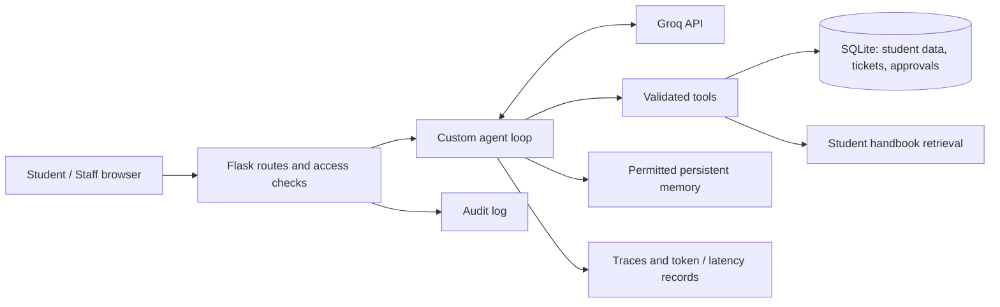

# Student Support AI

A Flask-based student assistance platform powered by **Groq**. Students can ask questions, check fees and scholarships, search a student handbook, raise support requests and request changes to their registered details. Staff manage students, tickets, approvals and activity records.

Built for the **Agentic AI Engineering** end-term assignments as a single application that combines an intelligent agent with privacy, authorization, human approval and auditability.

## Features

| Student portal | Administration |
|---|---|
| AI chat with conversation history and per-response metrics | Student accounts and account status |
| Fee and scholarship information | Ticket review and status updates |
| Student handbook search with cited sections | Approve/reject protected profile changes |
| Support tickets with replies and history | Activity and access audit records |
| Profile, password change and change requests | Agent performance and evaluation evidence |

**Approvals are not ordinary tickets.** A support ticket records a concern and staff replies. A registered name, email or phone change must be submitted as a structured change request; it appears under **Approvals**, and the change is applied only after staff approval. A ticket may be linked to that request. Rejecting the request leaves the student record unchanged.

## Architecture



The agent selects relevant context, decides whether to call a tool, validates requests, observes tool results, and returns a response within execution limits. Student identity and permissions are enforced in Flask/services, not merely in the AI prompt. Memory and retrieval use selected relevant data instead of the entire conversation or policy document.

## Run locally (Windows PowerShell)

Requires Python and a Groq API key.

```powershell
python -m venv .venv
.\.venv\Scripts\Activate.ps1
pip install -r requirements.txt
Copy-Item .env.example .env
# Edit .env and set GROQ_API_KEY and FLASK_SECRET_KEY
python run.py
```

Open **http://127.0.0.1:5000**. The database is initialized on the first run. Initial local account details are written to **`login.txt`**. Student accounts can be managed through the admin portal.

To verify or regenerate local account passwords:

```powershell
python scripts/provision_accounts.py --reset-passwords
```

Check Groq connectivity with:

```powershell
python scripts/groq_connectivity_test.py
```


## Agent evaluation and security

The course requires task success, tool selection, latency, input/output tokens, retrieved evidence, and a comparison after authorization and approvals are introduced. The `evaluations/` folder contains the question set, evaluation runners, and saved results; `docs/` records how both assignment requirements are addressed.

```powershell
python -m pytest -q
python -m evaluations.runners.run_eval --label a2_groq --mode groq --suite all --repeats 3
python -m evaluations.runners.compare
```

**Measurement note:** Included offline workflow results check application behavior, **not** live model accuracy; their token counts are unavailable. Run the Groq evaluation to record actual provider tokens and real-model latency before presenting model-performance results. Do not claim scores from tests you have not run.

**Security:** sessions, hashed passwords, ownership-scoped records, server-enforced permissions, required approval for protected changes, sensitive-memory filtering, and action audit logging. A student cannot retrieve another student's private data merely by asking the model or modifying request parameters.

## Project structure

```text
app/           Flask routes, agent, tools, services, models, templates, CSS/JS
data/          Student handbook and local seed setup
evaluations/   Question set, runners and recorded evaluation evidence
tests/         Agent, privacy, approval and workflow checks
scripts/       Account provisioning and Groq connection check
docs/          Assignment requirements and comparison
run.py         Start the Flask server
requirements.txt
.env.example
README.md
```
